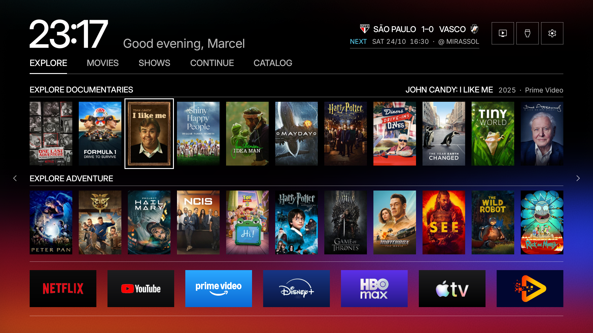

# Fase 1, extração dos tokens legados

Implementação no worktree `/Users/marcelgallo/free-my-tv-design`, branch `design-system`.
Base original: `8569d2127ac1577921764e6ea541dd798f085cb9`.
APK instalado a partir de `cf1ef71`, com autorização explícita de Marcel. O ADB retornou `Success`.

## Resultado

- Criado `app/src/io/freemytv/Theme.java`, com 293 constantes em `Theme.Legacy`.
- Migradas cores, tipografia, métricas principais, parâmetros de sombra e movimento de `HomeView` e `SettingsActivity`, além dos eixos de fonte em `Ui`.
- Criado `DESIGN_SYSTEM.md` com catálogo de tokens, valores, consumidores e estados dos componentes.
- Valores atuais preservados. Não foram aplicados grafite, laranja, Day, novos raios ou tipografia pontilhada.
- Assets, lógica de troca de home e arquivos protegidos preservados. Nenhum arquivo privado foi commitado.
- Sem push ou merge. A pasta principal não foi alterada por este trabalho.

## Verificações

| Verificação | Resultado |
|---|---|
| Build com JDK 17.0.20.1 e build.sh | Passou |
| Theme.java compilado contra android-28/android.jar | Passou |
| Assinatura do APK, mínimo API 28 | Passou |
| Classes originais | 75 binariamente idênticas; 3 com instruções equivalentes |
| Assets e recursos | 53 arquivos idênticos |
| Arquivos protegidos | Hashes iguais à referência |
| Instalação autorizada | Success |
| Home, regiões estáticas | Zero pixels diferentes em 1.911.600 pixels comparados |

O verificador de bytecode considera codificações equivalentes de constantes (`ldc`/`ldc_w`) e normaliza os destinos de salto por índice da instrução. Preserva constantes, assinaturas, instruções e fluxo de controle. Os testes de sensibilidade detectaram mudanças de valor e destino de salto. Isso complementa a comparação visual, não substitui testes de todos os estados na TV.

## Prints reais

Estado repetido com o controle: Explore, pôster John Candy: I Like Me selecionado, 1920 × 1080.

Antes, 23:13:

Depois, 23:17:

Exclusão da comparação: retângulo x=0..899, y=0..179, contendo relógio e saudação. A saudação segue a largura medida do relógio, comportamento original. As 9.738 diferenças da imagem completa estão apenas dentro desse cabeçalho, no retângulo x=289..800, y=63..163. Navegação, pôsteres, contorno de foco, dock, placar, utilidades e fundo ficaram idênticos.

Duas capturas logo após a instalação retornaram arquivos vazios. Após Marcel pressionar Home e repetir a seleção pelo controle, a captura funcionou. Arquivos vazios não foram mantidos.

## Limites e próximos checkpoints

- Este é o primeiro lote da extração. Há parâmetros visuais locais e caminhos auxiliares ainda não migrados; o inventário completo continua disponível.
- Gaveta e ajustes têm instruções compiladas equivalentes, mas ainda não há prints pareados dessas telas.
- Nenhuma conclusão de FPS, latência ou consumo de memória foi medida na TV.
- O novo visual só deve começar após o próximo OK. Antes de cada instalação, pedir nova autorização.
- Para retomar, usar este worktree e ler DESIGN_SYSTEM.md. Não usar a pasta do Claude Code nem fazer merge no branch sony-bravia-tweaks.

## Commits de implementação

- `e8b02c6`: docs: record design audit and pre-token build baseline
- `310f944`: refactor: extract legacy home colors and typography tokens
- `7d55c2b`: refactor: extract legacy home layout effects and motion tokens
- `cf1ef71`: refactor: extract legacy settings tokens without visual changes

O commit de evidências que contém este relatório vem depois desses commits.
