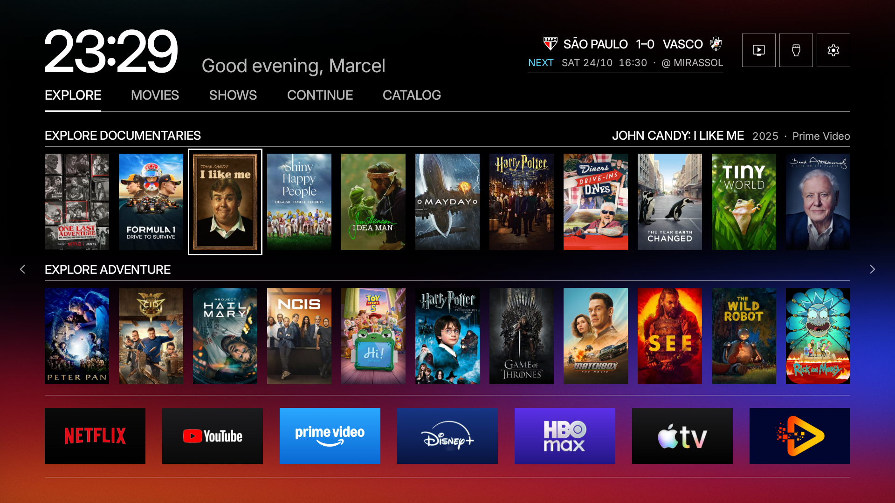
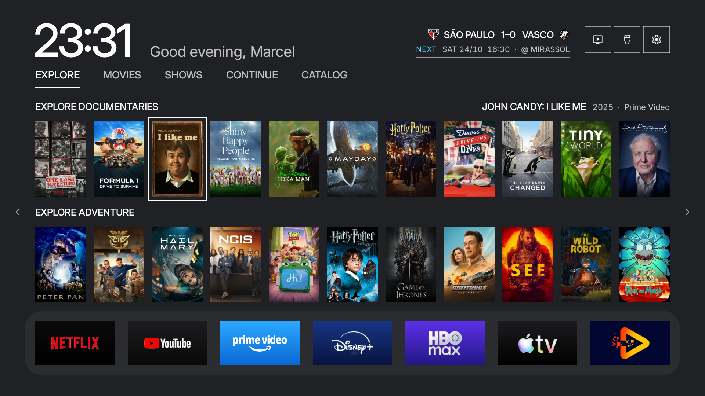
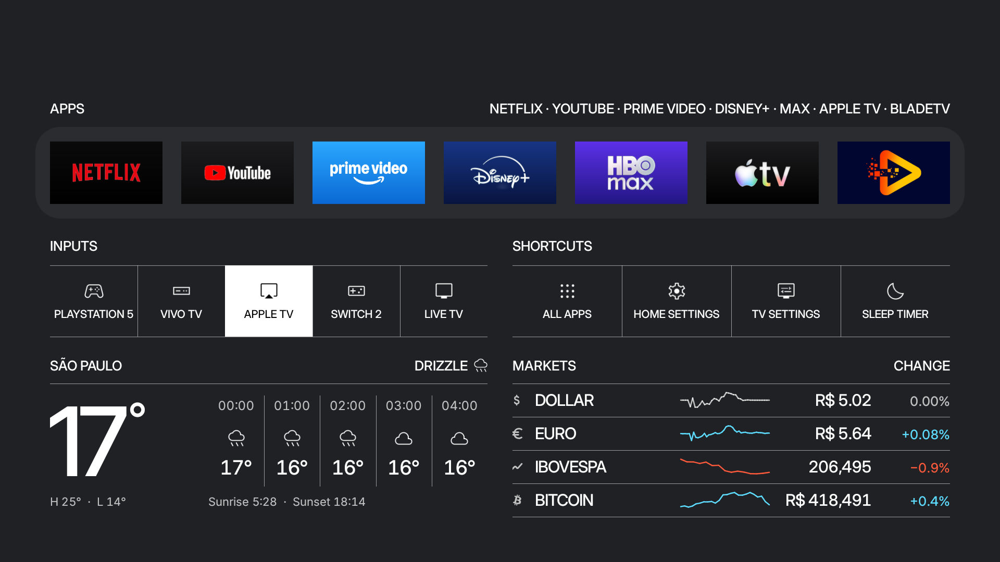

# Fase 2, fundo e barra de apps

Base validada: 9497a90. Worktree free-my-tv-design, branch design-system.

## Mudança instalada

- Fundo sólido #202124 na Home e na gaveta.
- Barra de apps opaca #2B2C2F, com raio de 48 unidades lógicas nos cantos.
- Mesmos bounds da barra e posições de apps e pôsteres. Foco e navegação preservados.
- HomeView deixa de carregar os bitmaps Ember e Ultramarine, e não redesenha o fundo a cada frame de abertura da gaveta.
- Os assets permanecem disponíveis para outros consumidores. Ajustes e screensaver não foram redesenhados.
- Day está apenas declarado como endpoint de fundo/superfície. A interface continua em Night.
- Abas e foco laranja, logos monocromáticos e demais formas serão trabalhados em checkpoints posteriores.

## Validação local

Build com JDK 17 concluído. Theme.java compila contra API 28. Assinatura do APK verificada para mínimo API 28. As 71 classes fora dos grupos alterados permaneceram idênticas ao build anterior. Assets e arquivos protegidos preservados.

Nenhum valor de Theme.Legacy foi trocado pelos valores novos. A verificação de identidade da fase 1 é histórica e não deve ser usada para exigir igualdade após este redesenho intencional.

## Checkpoint na TV

Instalação autorizada por Marcel, realizada com adb install -r e retorno Success. Commit de implementação: 01f6093.

Home capturada antes (23:29) e depois (23:31), com o pôster John Candy selecionado. Gaveta aberta pelo controle e capturada depois. Os pontos amostrados confirmaram #202124 no fundo e #2B2C2F na barra nas duas telas. O canto externo da barra também foi confirmado com a cor do fundo.

Esta etapa altera o visual intencionalmente. As 29 regiões de artes comparadas também apresentaram diferenças de pixels; a causa exata dessas diferenças não foi isolada. Não há afirmação de identidade pixel a pixel das artes nesta fase. A revisão do código confirmou que assets, layouts, tratamento das imagens, foco e ações não foram modificados. A gaveta não tem captura pareada anterior nesta etapa.

Amostras e métricas: phase2-pixel-check.json. Validações de build e instalação: phase2-verification.json. Próximo checkpoint: abas e foco laranja, apenas após o OK de Marcel. Antes da próxima instalação, pedir nova autorização.

Não há medição de desempenho na TV. A redução de carga de bitmaps é uma mudança de implementação, não uma promessa de ganho de FPS.
