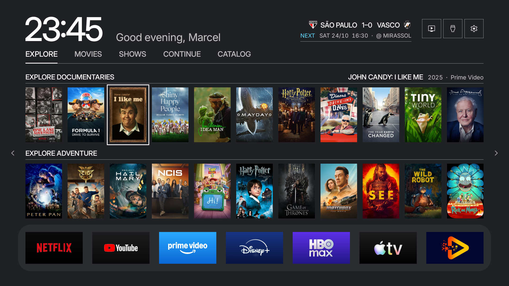
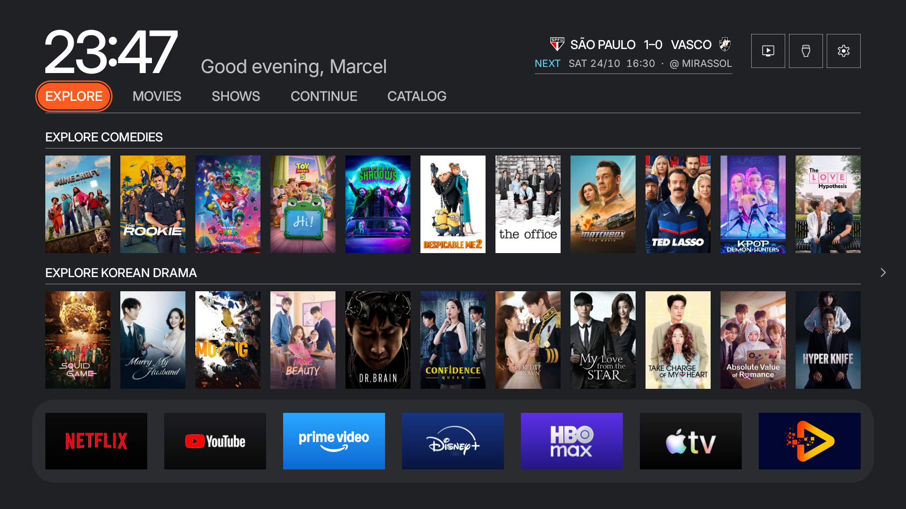

# Fase 3, Explore e foco laranja

Base: 55c83c9. Worktree free-my-tv-design, branch design-system.

## Mudança

- Aba ativa em cápsula #FF5A20, inclusive Explore. Texto branco grande.
- Anel externo de foco na aba, separado do preenchimento, para distinguir seleção e navegação.
- Contornos laranja nos pôsteres e apps. Preenchimento laranja e tinta escura nos controles focados da Home e da gaveta.
- Grade Todos os Apps com contorno laranja opaco no repouso do foco.
- Sem mudanças em navegação, assets, animações, dados, ajustes ou lógica de troca de home.

## Verificação local

Build JDK 17 concluído; Theme compila contra API 28; assinatura do APK validada. Apenas fontes HomeView.java e Theme.java alteradas. Classes fora desses grupos, assets, arquivos protegidos e tokens Legacy preservados. Relatório: phase3-verification.json.

## Checkpoint na TV

Instalação autorizada explicitamente por Marcel e concluída com retorno Success. APK conferido por SHA-256 antes da instalação. Home anterior capturada às 23:45, com John Candy selecionado. Home depois capturada às 23:49, novamente com John Candy selecionado e as mesmas fileiras. A captura intermediária às 23:47 mostra o foco sobre Explore, com outras fileiras do catálogo.

As amostras confirmam #FF5A20 no preenchimento de Explore e no contorno do pôster. O anel externo da aba aparece quando ela está focada, separado por uma faixa #202124. Quando o foco vai ao pôster, o anel desaparece e a cápsula permanece laranja. Fundo #202124 e dock #2B2C2F confirmados em ambas as capturas depois.

Relatório de amostras: phase3-pixel-check.json. Esta fase muda o visual intencionalmente; não afirma igualdade pixel a pixel da imagem completa. O relógio e a saudação variam entre capturas.

Foco dos apps, entradas e atalhos da gaveta, botões de utilidade e grade Todos os Apps foi atualizado no código, mas ainda não possui capturas específicas nesta fase. Sem medição de desempenho na TV.

Commit de implementação: f149f76. Nenhum push ou merge realizado. Próximo componente depende de novo OK de Marcel; uma próxima instalação exige nova autorização.
