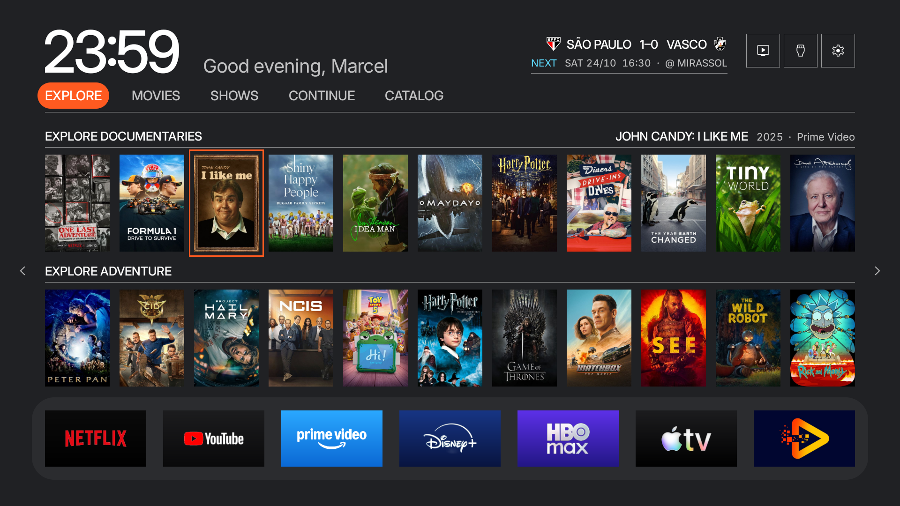
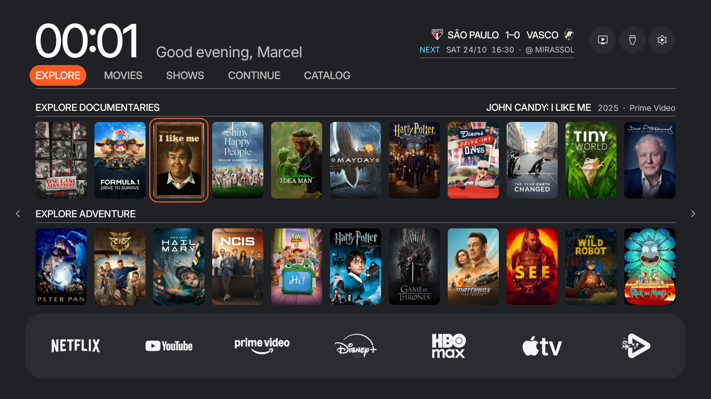
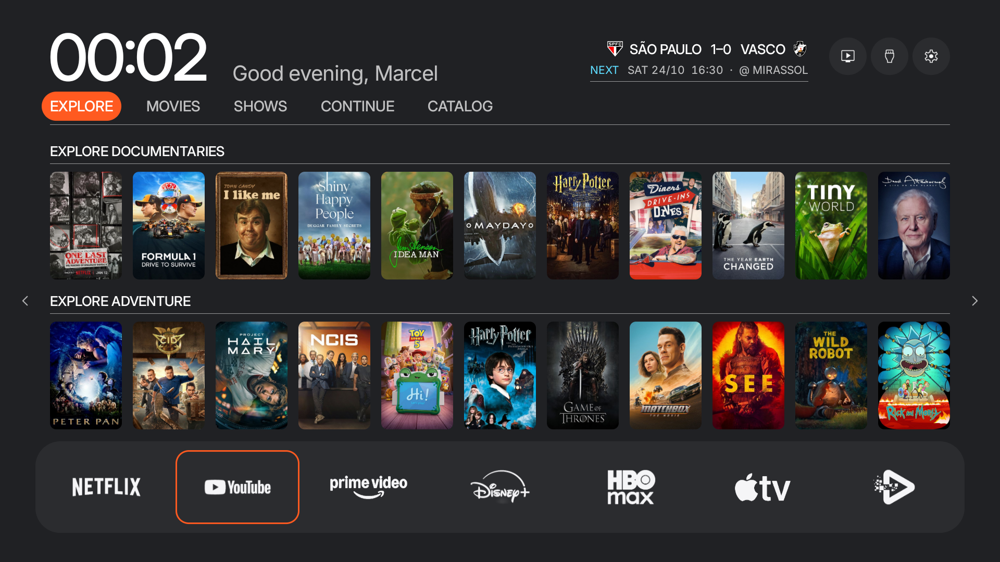

# Fase 4, logos monocromáticos e cantos arredondados

Base: 5fb9043. Trabalho exclusivo no worktree free-my-tv-design, branch design-system.

## O que muda

- Logos claros #F5F5F7 sobre o dock contínuo #2B2C2F; os fundos coloridos por app deixam de ser desenhados.
- Conversão usa as artes existentes e preserva o recorte do triângulo do YouTube. Máscaras calculadas no carregador de segundo plano e guardadas em memória.
- Apps personalizados também usam o extrator existente. Sem extração válida, o fallback é o banner em escala de cinza, com cantos suaves.
- Pôsteres e cards de conteúdo com raio 12; contorno laranja arredondado acompanha a imagem. Contorno dos apps com raio 24.
- Botões do cabeçalho circulares dentro das regiões existentes de 72 × 72, superfície grafite e foco laranja.
- Layout, seleção, navegação, ações, tamanhos dos pôsteres e molas mantidos. Sem alteração de preferências, lógica de home ou arquivos protegidos.

## Validação local

Build JDK 17 concluído. Theme, LogoMask, HomeApps e HomeView compilaram contra android-28.jar, usando core-lambda-stubs.jar do SDK para as lambdas existentes. Assinatura validada para mínimo API 28. Nove testes do conversor de máscara passaram. Sessenta e nove classes fora dos grupos alterados permaneceram binariamente idênticas ao build anterior. Assets e recursos preservados.

Nove métodos de layout e navegação foram comparados diretamente com a fase 3, sem alterações. Os tokens Legacy não mudaram. Relatório completo: phase4-verification.json. Teste reproduzível: tools/LogoMaskTest.java, compilado com LogoMask.java e executado em Java 17.

## Limites e checkpoint

Instalação autorizada explicitamente por Marcel e concluída com retorno Success. APK conferido por SHA-256 antes da instalação. Captura antes salva às 23:59, com John Candy selecionado. Home depois capturada às 00:01 de 22/10/2026, novamente com John Candy selecionado. YouTube em foco capturado às 00:02.

As capturas reais confirmam os sete logos monocromáticos, inclusive BladeTV extraído sem o banner de fallback. O triângulo do YouTube mostra a superfície do dock através do recorte. Pôsteres, contorno de John Candy e foco do YouTube apresentam cantos suaves. Os botões do cabeçalho estão circulares.

Quatorze amostras de pixels passaram: fundo #202124, dock #2B2C2F, foco #FF5A20, logo #F5F5F7, recorte do YouTube e pontos externos aos cantos arredondados. Nas sete regiões de logos, nenhum pixel excedeu diferença de cinco níveis entre os canais RGB, tolerância que inclui os tons neutros aprovados. As artes dos filmes continuam coloridas.

Amostras e contagens: phase4-pixel-check.json. Não há afirmação de igualdade pixel a pixel da imagem completa. Relógio e saudação variam entre capturas. Não houve captura separada da gaveta ou do foco sobre um botão circular.

A transformação depende da arte dos apps instalados. A rotina do YouTube pressupõe o botão vermelho reconhecível na arte existente. O teste cobre a conversão e transparência; a inspeção do logo real foi feita nas capturas desta TV. Não há medição de desempenho na Sony.

O dock compartilhado também muda na gaveta. Cards de clima, cotações e entradas, grade Todos os Apps, ajustes e Day continuam para outras etapas. Sem push ou merge.

Commit de implementação: a2ff4cb. A próxima etapa depende de novo OK de Marcel e a próxima instalação exige nova autorização.
